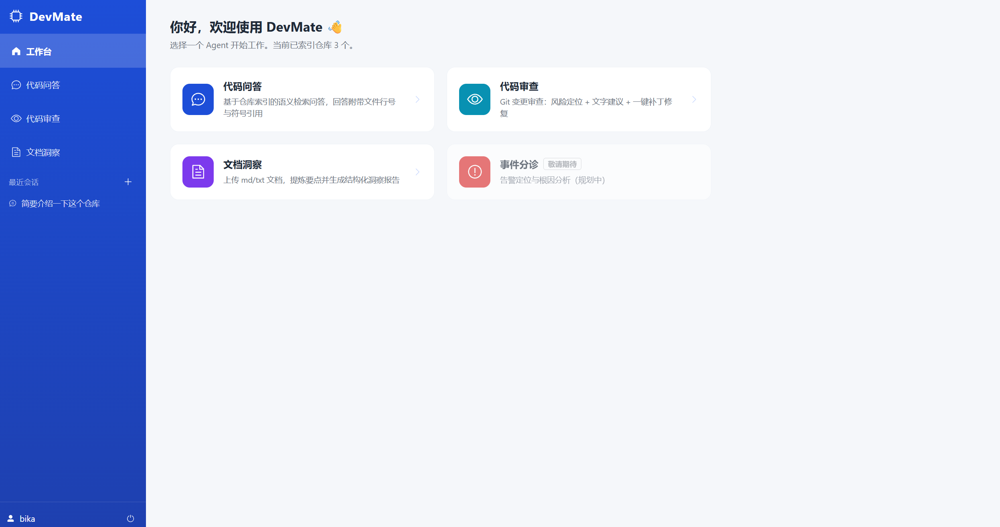
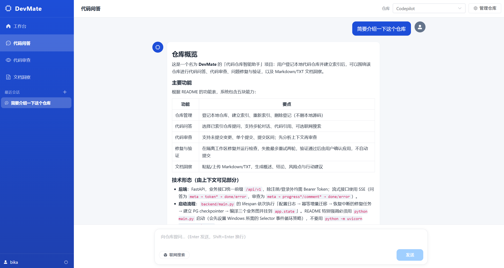
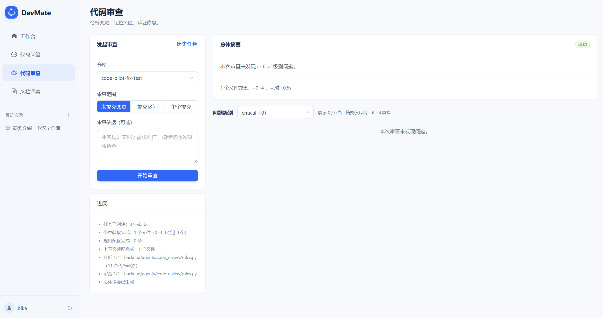
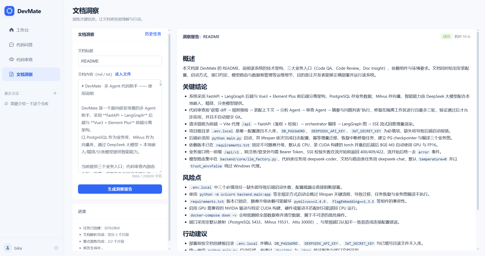

# DevMate · 多 Agent 代码助手 —— 使用说明

DevMate 是一个面向研发场景的多 Agent 助手，采用 **FastAPI + LangGraph** 后端与 **Vue3 + Element Plus** 前端分离架构，
以 PostgreSQL 作为业务库、Milvus 作为向量库，通过 DeepSeek 大模型 + 本地嵌入/精排/分类模型提供智能能力。

当前提供三个业务入口；代码审查内部由分析、审查、修复角色与验证工具协作：

| Agent | 能力 | 前端入口 |
| --- | --- | --- |
| **Code QA（代码问答）** | 基于仓库向量索引的 RAG 问答，支持多轮会话、引用溯源、可选联网搜索 | `/chat` |
| **Code Review（代码审查）** | 分析变更与调用上下文、审查风险；选中问题后在隔离工作区修复并验证，由用户确认应用 | `/review` |
| **Doc Insight（文档洞察）** | 上传 md/txt 文档，map-reduce 提炼要点并生成结构化洞察报告 | `/doc-insight` |

代码审查的核心流程：

```text
获取 diff → 规则预检 → 装配上下文 → 分析 Agent → 审查 Agent → 摘要与问题列表
                                                                    ↓ 用户选择问题
原工作树 ← 用户确认应用 ← diff 与验证证据 ← 隔离修复 + 验证（最多三轮）
```

分析 Agent 负责只读取证和理解变更，审查 Agent 负责生成问题；页面中的 `AI` 标签表示模型审查发现。
修复模型生成代码，验证工具实际执行测试或构建；验证通过后才允许确认应用，不自动提交 Git。

---

## 界面展示

**工作台**：三个可用业务入口，以及尚未启用的事件分诊卡片。



**代码问答**：RAG 流式回答，带引用溯源与联网搜索开关。



**代码审查**：未提交变更 / 提交区间 / 单个提交三种模式，流式进度 + 总体摘要。



**文档洞察**：上传 md/txt 文档，map-reduce 流式生成结构化洞察报告。



---

## 一、系统架构

```
code-pilot/
├── main.py                 # 后端本地启动入口（本地启动入口）
├── requirements.txt        # 后端 Python 依赖（版本已锁定）
├── docker-compose.yml      # 基础设施：PostgreSQL / Milvus / etcd / MinIO / Attu
├── .env.local              # 全部配置项（数据库、模型、密钥等）——不入库
├── scripts/
│   ├── init_db.sql         # 底座建表脚本（容器首次启动自动执行）
│   └── rebuild_vector_index.py # 索引恢复与重建工具
├── models/                 # 本地模型权重（离线，进程内加载）
│   ├── embedding/bge-m3            # 稠密+稀疏嵌入
│   ├── reranker/bge-reranker-large # 精排
│   └── classifier/all-MiniLM-L6-v2 # 意图分类
├── backend/
│   ├── main.py             # FastAPI 应用入口（lifespan：迁移→建图→挂路由）
│   ├── config.py           # 配置中心（读 .env.local）
│   ├── dependencies.py     # DB 会话 / 鉴权依赖 + Windows 事件循环守卫
│   ├── api/v1/             # 接口层：auth / code_qa / code_review / code_fix / doc_insight / repos
│   ├── agents/             # 各 Agent：graph / state / prompts / schema / 专用逻辑
│   │   ├── code_qa/        # 代码问答、索引与检索
│   │   ├── code_review/    # 审查主图、diff、规则与问题输出
│   │   │   ├── analysis/  # 审查前分析、只读代码工具与证据
│   │   │   └── fix/       # 隔离工作区、修复循环与验证执行器
│   │   └── doc_insight/    # 文档分块、提炼与报告
│   ├── core/               # 模型工厂、检索基建、持久向量缓存、记忆与日志
│   ├── db/migrations.py    # 幂等增量迁移（分布式 DDL 集中收集执行）
│   ├── services/           # orchestrator.py：SSE 编排；code_fix.py：后台修复任务
│   └── mcp/                # MCP server（knowledge_base / web_search）+ 统一客户端出口
└── frontend/               # Vue3 + Vite + TS + Element Plus + Pinia
    └── src/
        ├── api/            # http / sse / auth / codeQa / codeReview / codeFix / docInsight / types
        ├── views/          # Login / Home / Chat / Review / DocInsight
        ├── components/     # 问答引用、仓库管理、FixPanel、ReviewText 等
        ├── layouts/        # BasicLayout（侧边栏 + keep-alive）
        ├── router/         # 路由与登录守卫
        ├── stores/         # Pinia：auth / chat
        └── utils/          # markdown.ts / reviewText.ts
```

**数据流**：前端 → Vite 代理 `/api` → FastAPI（鉴权 + 校验）→ orchestrator 编排 → LangGraph 图（LLM / 检索 / MCP 工具）→ SSE 流式回推前端增量渲染。

---

## 二、环境要求

| 组件 | 版本要求 | 说明 |
| --- | --- | --- |
| Python | 3.11.x | 后端运行时（注意：3.11.0 有中文 traceback 缺陷，代码已规避） |
| Node.js | 18+（建议 22.x） | 前端构建 |
| Docker + Docker Compose | 最新稳定版 | 一键拉起 PG / Milvus 等基础设施 |
| DeepSeek API Key | 有效可用 | 所有 LLM 能力的必需项 |

**端口约定**（均与本机默认端口错开，避免冲突）：

| 服务 | 端口 |
| --- | --- |
| 后端 API | `8000` |
| 前端 Dev Server | `5173` |
| PostgreSQL | `5433`（容器内 5432） |
| Milvus | `19531`（容器内 19530） |
| Attu（Milvus 可视化） | `30000` |

---

## 三、快速开始

### 步骤 1 · 配置 `.env.local`

项目根目录下的 `.env.local` 是唯一配置源（已被 `.gitignore` 忽略，请勿提交真实密钥）。
必填项缺失会导致后端启动报错。参考模板：

```ini
# ===== 数据库（PostgreSQL）=====
DB_HOST=localhost
DB_PORT=5433
DB_NAME=copilot
DB_USER=copilot_user
DB_PASSWORD=<你的数据库密码>        # 必填

# ===== Milvus 向量库 =====
MILVUS_HOST=localhost
MILVUS_PORT=19531

# ===== DeepSeek 大模型 =====
DEEPSEEK_API_KEY=<你的 DeepSeek Key>  # 必填
DEEPSEEK_BASE_URL=https://api.deepseek.com
DEEPSEEK_MODEL_CHAT=deepseek-flash
DEEPSEEK_MODEL_CODER=deepseek-flash

# ===== 本地模型路径 =====
RERANKER_MODEL_PATH=./models/reranker/bge-reranker-large
CLASSIFIER_MODEL_PATH=./models/classifier/all-MiniLM-L6-v2
BGE_M3_MODEL_PATH=./models/embedding/bge-m3

# ===== 索引缓存与编码批大小（可选，以下为默认值）=====
EMBEDDING_CACHE_PATH=./.cache/embeddings.sqlite3
EMBEDDING_CACHE_MAX_ENTRIES=10000
EMBEDDING_BATCH_SIZE=16

# ===== JWT 认证 =====
JWT_SECRET_KEY=<随机长字符串>        # 必填
JWT_ALGORITHM=HS256
JWT_ACCESS_TOKEN_EXPIRE_MINUTES=10080

# ===== Web 搜索（博查，留空则联网搜索降级）=====
BOCHA_API_KEY=<可选>

# ===== 应用配置 =====
APP_ENV=local
APP_DEBUG=true
APP_HOST=0.0.0.0
APP_PORT=8000
LOG_LEVEL=INFO
```

> Docker Compose 复用同一份 `.env.local`（`DB_USER` / `DB_PASSWORD` 等），无需另配。

### 步骤 2 · 启动基础设施

```powershell
docker-compose --env-file .env.local up -d
```

- 首次启动会拉起 PostgreSQL、etcd、MinIO、Milvus、Attu。
- PostgreSQL 容器首次初始化时会自动执行 `scripts/init_db.sql`，建好 5 张底座表（users / repos / conversations / agent_runs / messages）。
- 用 `docker-compose ps` 确认各容器 `healthy` 后再继续（Milvus 依赖 etcd/MinIO 就绪，启动稍慢）。

### 步骤 3 · 安装后端依赖

```powershell
# 建议使用虚拟环境
python -m venv .venv
.\.venv\Scripts\Activate.ps1
pip install -r requirements.txt
```

> 依赖版本已在 `requirements.txt` 中锁定（如 `pymilvus==2.4.9`、`setuptools==80.9.0`、`FlagEmbedding==1.3.5`），请勿随意升级，否则会破坏兼容链。

**可选：启用 NVIDIA GPU / CUDA 向量计算**

项目自动检测 CUDA；仅安装 CPU 版 PyTorch 时，即使存在 NVIDIA 显卡也仍会使用 CPU。
在已验证的 Windows / RTX 3060 环境中，安装同版本 CUDA 构建：

```powershell
python -m pip install --force-reinstall --no-deps torch==2.5.1+cu124 --index-url https://download.pytorch.org/whl/cu124
python -c "import torch; print(torch.__version__, torch.version.cuda, torch.cuda.is_available())"
python -m pip check
```

需具备兼容的 NVIDIA 驱动；其他硬件和平台参考 [PyTorch 安装说明](https://pytorch.org/get-started/previous-versions/)。
确认 CUDA 可用后重启后端，BGE-M3 自动使用 GPU 和 FP16。模型通常在进程内首次使用时加载，
随后复用；内容向量缓存保存在磁盘，重启仍有效，CPU/GPU 精度使用不同缓存命名空间。

### 步骤 4 · 启动后端

```powershell
python main.py
```

启动流程（`backend/main.py` 的 lifespan）：配置日志 → 执行幂等增量迁移 → 恢复中断的修复任务 → 建立 PG checkpointer → 编译三个业务图并挂到 `app.state`。
看到日志 `db.migrations_done` 与 `app.graphs_ready` 即启动成功。

- API 根地址：`http://localhost:8000`
- 健康检查：`http://localhost:8000/healthz`
- 交互式 API 文档（Swagger）：`http://localhost:8000/docs`

> ⚠️ **务必用 `python main.py` 启动，不要用 `python -m uvicorn backend.main:app`**。该入口会在创建事件循环前设置 Windows 所需的 Selector 策略，保证 psycopg 异步连接可用。

### 步骤 5 · 启动前端

```powershell
cd frontend
npm install
npm run dev
```

- 打开 `http://localhost:5173`。
- 开发期 Vite 已把 `/api` 代理到 `http://127.0.0.1:8000`，前端直接请求 `/api/v1/...`，免 CORS。

---

## 四、功能说明

| 功能 | 使用方式 |
| --- | --- |
| **仓库管理** | 登记本地仓库并建立索引，支持重新索引和删除登记；删除登记不会删除本地源码。 |
| **代码问答** | 选择已索引的仓库提问，支持多轮对话、代码引用和可选联网搜索。 |
| **代码审查** | 选择未提交变更、单个提交或提交区间，系统先分析上下文再审查。问题卡片默认展示 critical，可切换其他级别；摘要仅概述 critical 风险。 |
| **修复与验证** | 选中审查问题，在隔离工作区修复并运行检查；首次尝试失败后最多重试两轮，通过验证后由用户确认应用到原工作树，不自动提交。 |
| **文档洞察** | 粘贴或上传 Markdown / TXT 文档，生成概述、关键结论、风险点与行动建议。 |

---

## 五、API 接口一览

所有业务接口前缀 `/api/v1`，除注册/登录外均需 Bearer Token。

### 认证 `/api/v1/auth`
| 方法 | 路径 | 说明 |
| --- | --- | --- |
| POST | `/auth/register` | 注册并返回 Token |
| POST | `/auth/login` | 登录返回 Token |
| GET | `/auth/me` | 校验 Token / 获取当前用户 |

### 仓库管理 `/api/v1/repos`
| 方法 | 路径 | 说明 |
| --- | --- | --- |
| GET | `/repos` | 当前用户仓库列表（含索引状态） |
| POST | `/repos` | 登记本地仓库（初始 `pending`） |
| POST | `/repos/{repo_id}/index` | 触发全量索引（后台异步） |
| DELETE | `/repos/{repo_id}` | 删除登记、索引及关联任务，不删除本地源码 |

### 代码问答 `/api/v1/code-qa`
| 方法 | 路径 | 说明 |
| --- | --- | --- |
| POST | `/code-qa/chat` | SSE 流式问答（`meta → token* → done/error`） |
| GET | `/code-qa/conversations` | 会话列表 |
| GET | `/code-qa/conversations/{id}/messages` | 历史消息回放 |

### 代码审查 `/api/v1/code-review`
| 方法 | 路径 | 说明 |
| --- | --- | --- |
| POST | `/code-review/tasks` | SSE 流式审查（`meta → progress*/comment* → done/error`） |
| GET | `/code-review/tasks` | 审查任务列表（最近 50） |
| GET | `/code-review/tasks/{task_id}` | 任务详情 + 全量 findings |
| POST | `/code-review/findings/{finding_id}/apply` | 旧接口返回 409，提示先修复验证 |
| POST | `/code-review/findings/{finding_id}/reject` | HitL 拒绝建议 |

### 修复验证 `/api/v1/code-fix`
| 方法 | 路径 | 说明 |
| --- | --- | --- |
| POST | `/code-fix/findings/{finding_id}/tasks` | 创建后台修复任务（202） |
| GET | `/code-fix/findings/{finding_id}/tasks` | 修复历史 |
| GET | `/code-fix/tasks/{task_id}` | 状态、diff、基线与每轮验证证据 |
| POST | `/code-fix/tasks/{task_id}/cancel` | 取消执行或放弃待确认结果 |
| POST | `/code-fix/tasks/{task_id}/apply` | 显式 `confirmed: true`，通过验证后应用 |

### 文档洞察 `/api/v1/doc-insight`
| 方法 | 路径 | 说明 |
| --- | --- | --- |
| POST | `/doc-insight/tasks` | SSE 流式洞察（`meta → progress* → token* → done/error`） |
| GET | `/doc-insight/tasks` | 洞察任务列表（最近 50，不含大字段） |
| GET | `/doc-insight/tasks/{task_id}` | 任务详情 + 完整报告与原文 |

**SSE 事件契约**：校验失败在流开始前以普通 HTTP 错误返回（400/409/422）；流开始后的失败统一走 `error` 事件。

---

## 六、大模型路由

`backend/core/llm_factory.py` 统一管理模型，按 Agent 类型路由（换模型只改路由表一行）：

| Agent 类型 | 模型 |
| --- | --- |
| `code_qa` / `code_analysis` / `code_review` / `code_fix` | deepseek-coder（代码理解/分析/审查/修复） |
| `doc_insight` / `incident_triage` / `summarize` / `route` | deepseek-chat（长文提炼/推理/短输出） |

- 默认 `temperature=0`。模型 SDK 不自动重试；问答流、单文件审查、分析输出纠正和修复循环分别按各自业务策略控制重试。
- 结构化调用使用 function calling，并单独关闭 DeepSeek 思考模式以兼容强制工具选择，不影响普通模型实例的配置。
- 通过自定义 httpx 客户端 `trust_env=False` 绕过系统代理，避免 Windows 代理导致 DeepSeek TLS 握手失败。

---

## 七、数据持久化

Docker 数据卷（`postgres_data` / `etcd_data` / `minio_data` / `milvus_data`）持久化，重启容器数据不丢。
彻底重置：`docker-compose down -v`（会删除所有数据卷，谨慎）。

本地 `.cache/` 保存可重建的向量缓存；本地模型、密钥、测试运行目录和缓存均不提交 Git。
